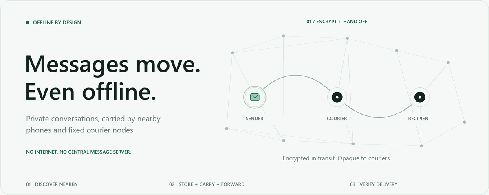

<div align="center">


# Hypha

### Private messages. No internet required.

An Android messenger and experimental relay network built around the devices already nearby.

<p>
  <a href="https://flutter.dev"></a>
  <a href="https://kotlinlang.org"></a>
  <a href="https://www.rust-lang.org"></a>
  <a href="https://www.espressif.com"></a>
  <a href="LICENSE"></a>
</p>

[Android preview](https://github.com/EruditeCoder108/Hypha/releases/tag/android-preview-2026-10-27) · [How it works](#how-it-works) · [Current capabilities](#current-capabilities) · [Build it](#build-it) · [Roadmap](docs/HYPHA_PRODUCTION_ROADMAP.md) · [Contribute](#contribute)

<picture>
  <source media="(prefers-reduced-motion: reduce)" srcset="assets/readme/hypha-network.svg">
  
</picture>

<sub>An illustration of store-and-forward delivery, not a radio simulation. [View the static version](assets/readme/hypha-network.svg).</sub>

</div>

## The network is the people

A message should be able to travel even when the internet cannot.

Hypha uses nearby phones to discover one another over Bluetooth Low Energy. After
contacts are verified, messages can travel directly or wait in an encrypted envelope
for another encounter. A courier carries that envelope without reading the conversation.
The sender and recipient do not have to be within range at the same time.

Wi-Fi Direct provides a separate path for encrypted attachments. Experimental ESP32
nodes add fixed BLE couriers. The next radio step is an ESP32-plus-LoRa transport
alongside the working BLE nodes.

**Today: an engineering prototype with recorded device tests.** Delivery depends on
encounters, available custody, and device behavior. Production security review and
wider device/lifecycle acceptance remain open.

## How it works

| Step | What happens |
| --- | --- |
| **01 · Discover** | Nearby Android phones find one another over BLE. Compare verification codes before trusting a contact. |
| **02 · Encrypt** | The sender creates a recipient-encrypted message. Couriers handle opaque envelopes. |
| **03 · Carry** | Available peers store and forward bounded copies as encounters occur. An experimental fixed node can act as a courier too. |
| **04 · Deliver** | The intended recipient processes the message and creates an authenticated receipt. That receipt travels back through an available path. |

**Custody is not delivery.** A relay accepting an envelope means it is carrying a copy.
Only a genuine recipient receipt can change the sender's message to **Delivered**.

<details>
<summary><strong>A little more about the privacy boundary</strong></summary>

- Plaintext, contacts, and endpoint decryption belong on the phones.
- The Rust crates implement recipient encryption, authenticated sessions, bounded
  messages, and receipts. Noise-based link encryption and recipient encryption serve
  different roles; encrypting a radio link alone does not make a message private from a relay.
- Fixed nodes store opaque text/receipt envelopes. They do not need a contact list or
  conversation plaintext to carry them.
- Managed Venue node approval, opaque-envelope admission, protected firmware, expiry,
  and physical recovery have separate acceptance gates.
- Encryption does not hide all timing, size, proximity, or radio metadata. Malicious
  couriers can withhold messages, and offline delivery has no fixed latency guarantee.

Read the [threat model](THREAT_MODEL.md), [protocol invariants](PROTOCOL_INVARIANTS.md),
and [architecture decisions](docs/decisions/) for the actual boundaries and open work.

</details>

## Current capabilities

These labels distinguish recorded device behavior from work still ahead. Device
results apply to the tested setup; they are not guarantees for every Android phone.

| Capability | Where it stands |
| --- | --- |
| **Direct private text, replies, and recipient receipts** | Implemented, with recorded physical passes. |
| **Phone → courier phone → recipient** | Recorded three-phone encrypted forwarding and receipt-return passes. |
| **Background delivery and reboot recovery** | Recorded on the tested phones; broader lifecycle and soak testing remains. |
| **Encrypted Wi-Fi Direct attachments** | Direct transfer, resume, cancellation, and recovery have recorded physical passes. |
| **Attachments carried by a phone** | Focused 11-chunk proof and receipt/cleanup semantics; the repeated large-file matrix remains open. |
| **ESP32 BLE text/receipt couriers** | Recorded one-node, two-node, and controlled three-node chain proofs. Experimental deployment. |
| **LoRa node links** | Planned. Live Hypha LoRa messaging is not implemented yet. |
| **Phone USB attachment** | A separate adapter still needs implementation. |
| **iOS, voice calls, and general media over ESP nodes** | Outside the current working prototype. |

The [production roadmap](docs/HYPHA_PRODUCTION_ROADMAP.md) is the execution plan.
The [project review](docs/PROJECT_REVIEW_2026-10-24.md) explains the mixed-node direction
and distinguishes the custom PCB experiment from the development-module path.

### The next engineering milestone

Keep the proven BLE path working while making custody reliable enough for another radio.

1. **Reconcile lost custody acknowledgements.** A receiver can currently retain a copy
   while an unacknowledged sender retains its original allowance. Durable, idempotent
   handoff recovery is the next priority.
2. **Finish ESP storage and expiry behavior.** Add interruption-safe eviction recovery,
   accumulated lifetime aging, and the required pressure-victim policy.
3. **Repeat the physical BLE baseline.** Exercise interruptions, restarts, and mixed peers
   while preserving identity and existing device data.
4. **Add the LoRa text/receipt adapter.** Bring up the selected development modules as a
   separate firmware target, then test them alongside ESP-only BLE nodes.

The latest repair checkpoint, **25 October 2026**, records **124 passing Android unit
tests across 24 suites** and a successful ESP32 compile. Its separate lost-ACK probe
still fails. These are dated software results, not a new physical acceptance run.
See the [repair report](docs/CUSTODY_REPAIR_2026-10-25.md) and
[validation evidence](evidence/custody-repair-2026-10-25/README.md).

## Inside Hypha

| Layer | Technology | Responsibility |
| --- | --- | --- |
| **Experience** | Flutter / Dart | Onboarding, Nearby, Chats, verification, message state, and settings. |
| **Android runtime** | Kotlin | Phone radios, encounters, background work, durable custody, and attachment orchestration. |
| **Protocol and cryptography** | Rust / JNI | Wire formats, authenticated sessions, recipient encryption, messages, receipts, routing models, and simulation. |
| **Fixed couriers** | ESP32 / C++ / LittleFS | Experimental authenticated BLE custody and fixed-node exchange. |

The Rust router/simulator, Android live store, and ESP firmware are separate
implementations with their own tests. A passing simulator does not prove that a
live radio or filesystem path behaves correctly.

```text
apps/mobile/              Flutter app and Android integration
crates/
  relay-wire/            Bounded outer-envelope encoding
  relay-message/         Authenticated application messages and receipts
  relay-secure/          Secure direct-session state machine
  relay-e2e/             Recipient-only asynchronous encryption
  relay-core/            Deterministic protocol state machine
  relay-router/          Routing policies and forwarding budgets
  relay-sim/             Encounter and delivery simulations
  relay-ffi/             Native ABI boundary
  relay-jni/             Android JNI bridge
hardware/esp32/           Working experimental BLE courier firmware
tools/                   Operator tools, vectors, and audit harnesses
docs/                    Decisions, roadmap, and engineering reports
```

## Build it

### Explore the Rust core

Install Rust with `rustup`. The repository pins its compiler and formatting/lint
components in [rust-toolchain.toml](rust-toolchain.toml).

```sh
git clone https://github.com/EruditeCoder108/Hypha.git
cd Hypha

cargo fmt --all --check
cargo test --workspace
cargo run -p relay-sim
```

The simulator explores encounter scenarios; its output is not a real-device latency
or coverage benchmark. Strict Clippy is also a development check, but the
[25 October audit](docs/DEEP_AUDIT_2026-10-25.md) records outstanding simulator lints;
it is not advertised as a passing gate.

### Build the Android app

Use Flutter with **Dart 3.12.2 or a compatible version allowed by pubspec**, an Android
SDK, and a JDK compatible with the checked-in Gradle/Android plugin versions.
The packaged native library targets **ARM64 Android**; an x86 emulator needs its
own native build.

```sh
cd apps/mobile
flutter pub get
flutter analyze
flutter test
flutter build apk --debug --target-platform android-arm64
```

The debug APK is written to `apps/mobile/build/app/outputs/flutter-apk/app-debug.apk`
relative to the repository root. Native bridge changes require rebuilding the Rust
library before packaging. See the [mobile build guide](apps/mobile/README.md) for
Android tests and the native rebuild path.

Building can require internet access to obtain toolchains and dependencies. The
messaging paths themselves are designed to work without an internet service or API key.
Use separate test devices or disposable data for development.

### Work on fixed nodes

Start with the [ESP32 firmware guide](hardware/esp32/README.md). It documents the
ESP-only BLE target, provisioning, experimental limits, and physical acceptance work.
Custom-board and vendor-reference experiments are outside this initial public source snapshot.

## Read the engineering

| Start here | What you will find |
| --- | --- |
| [Production roadmap](docs/HYPHA_PRODUCTION_ROADMAP.md) | Current priorities and source/physical/production acceptance gates. |
| [How Hypha works](How_Hypha_works.md) | A longer introduction to the project. Use the current roadmap for implementation status. |
| [Protocol invariants](PROTOCOL_INVARIANTS.md) | Rules that each transport and feature must preserve. |
| [Threat model](THREAT_MODEL.md) | Adversaries, protected assets, non-goals, and open security boundaries. |
| [Architecture decisions](docs/decisions/) | Rationale behind sessions, contacts, messages, couriers, and venue policy. |
| [Deep audit and repair](docs/CUSTODY_REPAIR_2026-10-25.md) | Reproduced failures, implemented fixes, evidence, and remaining work. |
| [Audit tooling](tools/audit/README.md) | Reproducible host/Android probes with explicit limits. |

## Contribute

Good first areas are reproducible custody failures, Android lifecycle behavior,
bounded parser/resource handling, accessibility, and radio-adapter boundaries.

- Read the protocol invariants and the relevant architecture decision before changing a wire format.
- Keep firmware targets separate so a new radio does not silently break BLE-only nodes.
- Include a minimal synthetic reproduction and label results as source, host, emulator, or physical evidence.
- Use synthetic contacts and messages. Keep device databases, private keys, real chats,
  identifying screenshots, and raw personal traces out of issues and pull requests.

Before a public release, complete the
[publication readiness review](docs/OPEN_SOURCE_READINESS_2026-10-27.md). Repository
privacy and product security are separate gates.

## License and acknowledgements

Hypha's original software, documentation, and code-generated README artwork are
licensed under **[PolyForm Noncommercial 1.0.0](LICENSE)**. This is source-available
software for the license's permitted noncommercial purposes. Commercial use requires
separate permission; there is no automatic conversion to a commercial-use-permitting
license. See [the license policy](docs/LICENSE_POLICY.md) and [NOTICE](NOTICE).
Vendor references, libraries, test vectors, and other third-party material retain
their own licenses and notices.

The header uses the existing approved Hypha mark. Technology badges identify the
actual stack; they do not imply endorsement. The animated illustration is drawn
from code and contains no device screenshots or contact data.

---

<div align="center">
<strong>Built for the moments between connections.</strong><br>
<sub>Hypha · Project Relay</sub><br>
<sub>[Repository card PNG](assets/readme/repo-card.png) · [Editable SVG template](assets/readme/repo-card-template.svg)</sub>
</div>
